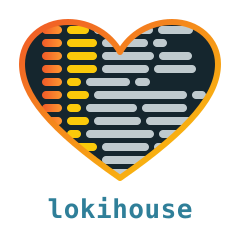

<div align="center">
  

  <h1>Rúnakefli <small>[ˈruːnaˌkɛvli]</small></h1>
  <p><strong>The Loki® HTTP API, with logs stored in ClickHouse®.</strong></p>

  [](https://github.com/bzed/runakefli/actions/workflows/ci.yml)
  [](https://codecov.io/gh/bzed/runakefli)
  [](https://pkg.go.dev/github.com/bzed/runakefli)
  [](https://runakefli.app/)
  [](LICENSE)
  [](docs/roadmap.md)
</div>

---

> **Release candidate.** Rúnakefli is feature complete and passes the Loki
> compatibility oracle, but has not yet been proven in production. Packages and
> images are built from every release. Back up the ClickHouse database before
> upgrading; schema changes ship with a migration (`-schema.migrate`).

Rúnakefli (`runakefli` on the command line and in packages) is a single static Go service that speaks
[Loki](https://grafana.com/oss/loki/)'s HTTP API (push, LogQL queries,
labels, series, tail, index statistics, deletes and the ruler) and stores the
logs in [ClickHouse](https://clickhouse.com/). Point Grafana®, Alloy or
Promtail at it as if it were Loki; ClickHouse does the storage and the heavy
lifting.

**Built with**
[](https://go.dev/)
[](https://github.com/grafana/loki)
[](https://clickhouse.com/)
[](https://www.debian.org/)
[](https://claude.com/claude-code)

## What you get

- **Loki's API, unchanged.** The same endpoints, the same LogQL, the same error
  messages and configuration keys wherever Loki has them. Loki's own parser,
  engine and ruler code is reused rather than re-implemented, at one pinned Loki
  commit.
- **Proven equality.** A differential test suite (the "oracle") runs the same
  data and queries against real Loki and compares the answers. Every accepted
  difference is listed, with its reason, in
  [`docs/divergences.md`](docs/divergences.md).
- **ClickHouse underneath.** Single server, or a cluster with replicated and
  distributed tables. Credentials can come from a `password_file`.
- **One binary.** Static (`CGO_ENABLED=0`), no runtime dependencies besides a
  ClickHouse server.

## The name

**Rúnakefli** is Old Norse for a *rune stick*: *rún*, a rune, and *kefli*, a
stick or short piece of wood. On the command line, in package names and in
paths it is spelled `runakefli`.

How to say it: *ROO-nah-KEV-lee*. The *ú* is a long "oo" as in "moon", the
stress falls on the first syllable with a lighter one on *kef*, and the *f*
between the vowels is a *v*, as medieval Old Norse is usually reconstructed.
In modern Icelandic the *fl* is pronounced like *pl*, so an Icelander would say
something closer to *ROO-nah-KEP-lee*. Either is fine, and so is reading
`runakefli` on the command line the same way.

In medieval Scandinavia, writing was not reserved for kings, monks and poets.
Runes were an everyday script. They are made of straight strokes that are easy
to cut with a knife, and a stick of wood was the most ordinary notebook there
was. The best evidence comes from Bergen in Norway. After a fire destroyed part
of the old Bryggen waterfront in 1955, archaeologists dug there and found some
670 medieval runic inscriptions, most of them on wood (mostly pine) and some on
bone, kept in the damp ground for centuries. They date from the twelfth to the
fourteenth century.

What makes them remarkable is how ordinary they are. They are not sagas. They
are the small, practical things people needed to say or keep track of:
ownership marks (*Eysteinn á mik*, "Eystein owns me"), business letters and
orders, receipts and tallies, prayers (*Ave Maria*), love notes (*Ást mín, kyss
mik*, "my love, kiss me"), a verse, a secret message urging someone to change
sides in a civil war, and *Gyða tells you to go home*. Some of it is rude, and
some of it is very human.

That is why the name fits a log server. A log is a piece of wood and a record
of what happened. A rune stick is both: a small, durable object covered in
short lines, one after the other, written by many different hands for many
different reasons, kept, and read again later by someone who needs to know what
was said, who owned what, and what went wrong. Rúnakefli does the same for the
log lines of your systems, and the logo shows them as rows of short strokes,
like cuts in a stick, in the shape of a heart.

See the [Bryggen inscriptions](https://en.wikipedia.org/wiki/Bryggen_inscriptions)
for the finds and their translations.

## Speed

Query latency against Loki on identical data and queries (200 000 lines, 50
streams, one node each, p50, Rúnakefli at main with the speculative stream
read; every answer is compared with Loki's before it counts):

| query | Loki | Rúnakefli |
|---|---:|---:|
| `count_over_time` | 53 ms | **14 ms** |
| `topk` | 25 ms | **11 ms** |
| `bytes_over_time` | 25 ms | **15 ms** |
| `logfmt` filter | 46 ms | **19 ms** |
| `rate` with regex | 14 ms | 14 ms |
| plain log filter | 5.5 ms | 5.5 ms |
| `unwrap` + `quantile_over_time` | **49 ms** | 56 ms |

On object storage (flushed Loki chunks against ClickHouse on S3 with its
filesystem cache; p50, ms), on a local RustFS and on a remote S3 bucket
(separate runs; the remote bucket figures are from an earlier run, before the
speculative stream read, which is why its plain log filter is still 8 ms):

| query | Loki, RustFS | Rúnakefli, RustFS | Loki, remote S3 | Rúnakefli, remote S3 |
|---|---:|---:|---:|---:|
| `count_over_time` | 51 | **14** | 65 | **12** |
| `topk` | 24 | **12** | 32 | **11** |
| `bytes_over_time` | 24 | **15** | 31 | **14** |
| `rate` with regex | **13** | 14 | 17 | **13** |
| `logfmt` filter | 29 | **20** | **26** | 33 |
| plain log filter | **5** | 6 | **5** | 8 |
| `unwrap` + `quantile_over_time` | **48** | 56 | **61** | 63 |

Rúnakefli is 1.7–4× faster on the aggregations and the `logfmt` filter, level
with Loki on the plain log filter and `rate` with regex, and 1.1–1.2× slower on
`unwrap` + `quantile_over_time`; `labels` (about 2 ms) and `series` (2–3 ms)
are 1–2 ms slower than Loki's. Without ClickHouse's filesystem cache, S3 reads add
2–13 ms.

Method, environment and caveats: [`docs/benchmark.md`](docs/benchmark.md).

## Install

**Debian 13 "trixie"** (amd64, arm64), from the signed apt repository:

```console
$ sudo install -d -m 0755 /etc/apt/keyrings
$ sudo curl -fsSLo /etc/apt/keyrings/runakefli-archive-keyring.asc https://runakefli.app/apt/runakefli-archive-keyring.asc
$ sudo tee /etc/apt/sources.list.d/runakefli.sources <<'EOF'
Types: deb
URIs: https://runakefli.app/apt
Suites: trixie
Components: main
Signed-By: /etc/apt/keyrings/runakefli-archive-keyring.asc
EOF
$ sudo apt update && sudo apt install runakefli
```

The key's fingerprint is `74E9 21AC B040 DCC7 2C02  A144 1193 7B6E A8AF C649`.
Edit `/etc/runakefli/runakefli.yaml` (the service is not started on install),
then `sudo systemctl enable --now runakefli`.

**Container** (linux/amd64, linux/arm64):

```console
$ podman run -d -p 3100:3100 -e RUNAKEFLI_CLICKHOUSE_ADDR=clickhouse.example.org:9000 ghcr.io/bzed/runakefli:latest
```

ClickHouse credentials: `-e RUNAKEFLI_CLICKHOUSE_USER=...` and either
`-e RUNAKEFLI_CLICKHOUSE_PASSWORD=...` or, preferably, a mounted file named by
`-e RUNAKEFLI_CLICKHOUSE_PASSWORD_FILE=...`
([details](https://runakefli.app/install/#clickhouse-password)).

**From source** (a ClickHouse server 26.9 or later and a recent Go toolchain, see `go.mod`):

```console
$ podman run -d -p 9000:9000 -e CLICKHOUSE_SKIP_USER_SETUP=1 docker.io/clickhouse/clickhouse-server:26.9
$ make build
$ cat > runakefli.yaml <<'YAML'
server:
  http_listen_port: 3100
clickhouse:
  addr: ["localhost:9000"]
  database: runakefli
  username: default
YAML
$ ./bin/runakefli -config.file runakefli.yaml
```

Then use it like Loki, for example as a Loki data source at
`http://localhost:3100`. [`runakefli.example.yaml`](runakefli.example.yaml) lists
the optional keys; the [installation guide](docs/install/index.md) has the
details, including systemd.

## Documentation

Full documentation: **<https://runakefli.app/>**

- [Installation](docs/install/index.md) and [migrating from Loki](docs/migrating.md)
- [Configuration](docs/reference/configuration.md) and [HTTP API](docs/reference/http-api.md)
- [Operations](docs/operations.md) and [benchmarks](docs/benchmark.md)
- Design: [`docs/superpowers/specs/2026-10-10-clickhouse-loki-design.md`](docs/superpowers/specs/2026-10-10-clickhouse-loki-design.md)
- Known differences from Loki: [`docs/divergences.md`](docs/divergences.md)
- What is left to do: [`docs/roadmap.md`](docs/roadmap.md)

## Development

Read [`AGENTS.md`](AGENTS.md) first; it holds the rules for every change, by
humans and by coding agents. [`docs/development.md`](docs/development.md) has
the details.

```console
$ make check            # format, vet, lint, govulncheck, tests with -race, coverage >= 85 %
$ make test-cluster     # the same against a ClickHouse cluster
$ make oracle-all       # differential tests against real Loki
```

## Trademarks

Loki® and Grafana® are trademarks of Grafana Labs. ClickHouse® is a registered
trademark of ClickHouse, Inc. Debian is a registered trademark of Software in
the Public Interest, Inc. Claude is a trademark of Anthropic. Rúnakefli is an
independent project, not affiliated with, endorsed or sponsored by Grafana Labs,
ClickHouse, Inc. or any of the others; the names are used only to say what it
works with. The logo is original artwork and does not use their logos.

## License

AGPL-3.0, see [`LICENSE`](LICENSE).
