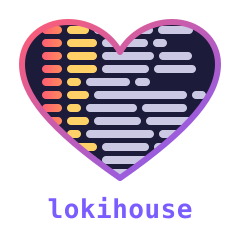

# lokihouse

> **Release candidate.** lokihouse is feature complete and passes the Loki
> compatibility oracle, but has not yet been proven in production. Debian
> packages (amd64, arm64) and container images are built from every release.
> The ClickHouse schema may still change between releases without a migration. See the
> [installation guide](install/index.md).

lokihouse is a single Go service that speaks Grafana Loki's HTTP API (push,
LogQL queries, labels, series, tail, index statistics, deletes and the
ruler) and stores the logs in ClickHouse. Feature equality with Loki is
checked by a differential test suite that runs the same data and queries
against real Loki.

## Who is this for

- **[I want to install lokihouse](install/index.md)** — a sysadmin who has never
  run lokihouse and wants one running on a bare machine.
- **[I'm migrating from Loki](migrating.md)** — a sysadmin running stock Loki
  who wants to swap Loki for lokihouse. A full cutover runbook, the
  behavioural differences to know about, and a verification checklist.

## Reference

- [Configuration](reference/configuration.md) — every config key, with
  defaults.
- [HTTP API](reference/http-api.md) — every endpoint lokihouse serves.
- [Divergences](reference/divergences.md) — pointer to the canonical list of
  differences from Loki.
- [About / License](about.md) — AGPL-3.0, links to the design and status docs.

## Source

Source code and the canonical developer docs (per-phase status, the
detailed divergences list, the design spec) live in the
[GitHub repository](https://github.com/bzed/lokihouse).
